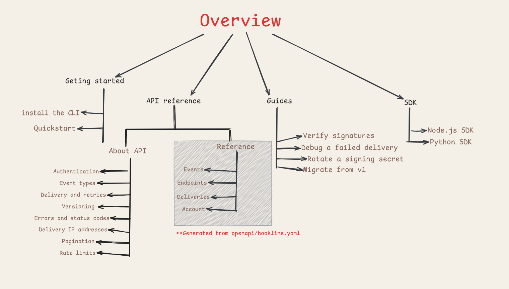
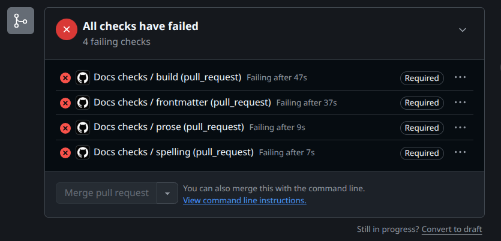

# Hookline docs: a documentation pipeline

**Live site:** [manueldezman.github.io/hookline-docs](https://manueldezman.github.io/hookline-docs/)
· **For agents:** [llms.txt](https://manueldezman.github.io/hookline-docs/llms.txt)

Hookline is a fictional webhook delivery API, but the documentation system around it is real and running. This repository shows how I set up docs-as-code quality gates and an agent-ready output layer on Docusaurus, and how each piece is tested.

## What the pipeline does

Every content change passes through automated gates before it reaches the published site:

| Check | Tool | When it runs | What it blocks |
| --- | --- | --- | --- |
| Style and terminology | Vale | Pull request | Errors block the merge |
| Spelling | codespell | Pull request | Any known misspelling blocks the merge |
| Front matter | `check-frontmatter.js` (Node) | Pull request | Missing or malformed metadata blocks the merge |
| Internal links and build | Docusaurus | Pull request and deploy | Any broken internal link blocks the merge and the deploy |
| Agent-file parity | `validate-agent-files.js` and Node tests | Pull request and deploy | Any missing or broken agent file blocks the merge and the deploy |
| External links | Lychee | Push to `main` and weekly | Any dead URL fails the run. It doesn't block merges |

## How the docs are organized

The site splits into four areas, and each area carries the same name in the header nav, the sidebar, the URL and the folder under `docs/`. A reader who learns one name can predict the other three.



| Area | The question it answers |
| --- | --- |
| Getting started | What do I do first? |
| Guides | How do I complete this task? |
| API reference | What are the exact fields and methods? |
| SDK | How do I call this from code? |

`Changelog` and `Support` stay in the header as actions rather than sections. Changelog is a single page with no sidebar of its own, and Support is a `mailto:` link, so neither belongs in the hierarchy.

### Decisions behind the hierarchy

- **The build fails when the structure drifts.** `sidebars.ts` is typed, so a sidebar entry pointing at a deleted page fails the build. Front matter is a gate, the build fails on any broken internal link, and `npm run check:api` fails when a generated page drifts from the OpenAPI spec.
- **Concepts sit apart from reference.** `About API` explains behavior and `Reference` lists fields and methods. The eight concept pages are hand-written, the reference pages are generated from `openapi/hookline.yaml`, and the diagram shades the generated half. Mixing the two is what makes API docs hard to navigate.
- **Every method page has the same shape.** Path parameters, request body, request examples in curl, Node.js and Python, then responses grouped by status code. A reader who has read one page has read them all.
- **Troubleshooting belongs to the question that raises it.** The status code lookup lives in the API area, the failed-delivery walkthrough lives in Guides, and short versions sit inline on the pages that need them. Neither page is a dumping ground for the other.
- **Depth stops at three levels.** Area, topic, page. Each area also has its own sidebar, so a reader in Guides never sees API navigation.
- **Search is a fourth path through the same hierarchy.** The index is local and client-side, built from the docs only, with term highlighting on the target page and a keyboard shortcut. A query with no results is a dead end unless it offers a next step, so `src/clientModules/searchEmptyState.js` appends a hint and a link back to Getting started. The plugin renders its dropdown as an HTML string, which is why that patch reaches it through the DOM. The results page it links to stays outside the four areas and outside the agent output, because it is a lookup tool.
- **The landing page owns the root.** `docs/index.md` is the overview at `/docs/`, and `/` is a redirect route rather than a static redirect, because the theme links to the home page from the navbar logo and the 404 page.

## What each tool demonstrates

I picked each tool to catch one specific failure.

### Vale: prose style and custom rules

Vale is a prose linter. Its rules are YAML files grouped into styles. This site runs four rule sources, configured in [`.vale.ini`](.vale.ini):

| Rule source | Rules I rely on | Severity |
| --- | --- | --- |
| **Vale built-in** | `Vale.Terms` enforces the spelling and capitalization of every term in the project vocabulary (`Hookline`, `Docusaurus`, `MDX`, `HMAC`, `SDK`, `CLI`, `Node.js`). `Vale.Repetition` catches repeated words. `Vale.Spelling` is turned off, because codespell owns spelling | `Terms`, `Repetition`: error |
| **Google developer documentation style** | `Google.Headings` requires sentence-case headings. `Google.WordList` applies preferred spellings. `Google.Latin` requires "for example" instead of "e.g.". `Google.Passive`, `Google.Will`, and `Google.We` push toward active voice, present tense, and second person | `Headings`, `WordList`, `Latin`: error. `Passive`, `Will`, `We`: warning |
| **Custom style (`Hookline`)** | [`Hookline.Webhook`](.vale/styles/Hookline/Webhook.yml) uses Vale's `substitution` extension to flag `web hook`, `web-hook`, and their plurals, and asks for `webhook` | error |
| **Project vocabulary** | [`accept.txt`](.vale/styles/config/vocabularies/Project/accept.txt) lists the product and tool names that are always correct | n/a |

- **Only `error` blocks a merge.** Rules I consider style advice (passive voice, "will") stay at `warning`, so they show up in review without stopping a contributor. Rules I consider correctness (heading case, product-name spelling) are errors.
- **JSX tags are ignored.** MDX pages contain tags like `<TabItem value="npm">`. A `TokenIgnores` pattern keeps Vale from treating them as prose.

### codespell: spelling

codespell checks `docs/` and this README on every pull request. It matches text against a maintained list of common misspellings. That keeps false alarms on product names and code terms low. The trade-off is that it misses typos that aren't on its list. [`.codespellrc`](.codespellrc) skips generated and vendored folders.

### Front matter check: metadata as a gate

[`scripts/check-frontmatter.js`](scripts/check-frontmatter.js) parses every page with `gray-matter` and fails on:

- a missing or empty `title` or `description`
- a `description` longer than 160 characters
- malformed YAML, such as an unclosed quote

The description matters beyond SEO: it becomes the link text for that page in `llms.txt`.

### Docusaurus: internal link checker

I set `onBrokenLinks`, `onBrokenAnchors`, and `markdown.hooks.onBrokenMarkdownLinks` to `throw` in [`docusaurus.config.ts`](docusaurus.config.ts). A dead link to another page, a missing `#heading`, or a bad `[text](./file.md)` link now fails the build instead of shipping.

### Lychee: external links checker

Internal links only change when someone edits the docs. External links can break with no change to the repo. So Lychee runs on every push to `main` and every Monday at 06:00 UTC. The scheduled run is the useful one, because it finds link rot when nobody has touched the repository.

Lychee scans the built HTML, so it also sees links generated inside components. [`lychee.toml`](lychee.toml) does four things: resolves root-relative links against the site origin, accepts any 2xx status plus `429` (rate limited) so busy sites don't cause false failures, retries flaky links three times, and excludes localhost, example domains, the not-yet-deployed site itself, and the fictional API host.

### Node tests: Markdown serializer

The agent layer converts MDX to Markdown with a custom script. [`scripts/agent-files.test.js`](scripts/agent-files.test.js) holds six regression tests on that converter, using Node's built-in test runner: tabs keep their labels and code, inline code containing tags survives, admonitions convert, unknown components keep their children, links and images become absolute, and page routes follow Docusaurus's rules.

## The GitHub Actions workflows and the gates

Three workflows wire the tools together.

| Workflow | Trigger | What it runs |
| --- | --- | --- |
| [`docs-checks.yml`](.github/workflows/docs-checks.yml) | Pull request | Four parallel jobs: `prose` (Vale), `spelling` (codespell), `frontmatter`, and `build` (tests, Docusaurus build, agent-file validation) |
| [`links.yml`](.github/workflows/links.yml) | Push to `main`, weekly cron, manual | Builds the site, then runs Lychee |
| [`deploy.yml`](.github/workflows/deploy.yml) | Push to `main`, manual | Builds, validates the agent files, then publishes to GitHub Pages |

### Deploy previews

Netlify builds pull requests only. Every PR gets its own preview URL, and production stays on GitHub Pages. [`netlify.toml`](netlify.toml) skips every context except `deploy-preview`, sets the build command and publish directory, and sets `SITE_BASE_URL=/` because Netlify serves from the domain root while GitHub Pages serves from `/hookline-docs/`.

`docusaurus.config.ts` and `scripts/agent-files.js` read `SITE_ORIGIN` and `SITE_BASE_URL`, so one codebase builds correctly for both hosts. When they are unset, the GitHub Pages values apply.

### How a gate works

A lint only blocks a merge when the repository requires it. `main` is protected: a pull request can't merge until `prose`, `spelling`, `frontmatter`, and `build` have all passed. The four jobs are independent and run in parallel, so one failure doesn't hide the others. A contributor sees every problem in one round instead of fixing them one at a time.

### Design choices

- **Deploy validates first.** `deploy.yml` runs the agent-file validator before it publishes, so a broken `llms.txt` can't go live.
- **`npm ci` and a committed lockfile.** CI installs exactly the versions I tested.

### A check doing its job

[Pull request #2](https://github.com/manueldezman/hookline-docs/pull/2) is a deliberately broken change. It exists to show the required checks blocking a merge.



| Mistake in the pull request | Check that caught it |
| --- | --- |
| Writes 'hookline' instead of 'Hookline' | `prose` (Vale.Terms) |
| Misspells 'service' | `spelling` (codespell) |
| Omits the `description` in `docs/intro.md` | `frontmatter` |
| Links to a missing page, `./sending-events-typo.md` | `build` |

## Agent-facing documentation

AI agents and search tools increasingly read documentation as Markdown rather than as rendered HTML. The rendered site never has to answer whether the version an agent reads matches the version a human sees. This site checks that answer after every build.

### What it publishes

| Output | URL | Purpose |
| --- | --- | --- |
| A Markdown twin of every page | Add `.md` to any page URL, for example `/docs/quick-start.md` | The page as Markdown, with components resolved |
| `llms.txt` | `/llms.txt` | An index of every page with its description, following the llmstxt.org layout |
| `llms-full.txt` | `/llms-full.txt` | Every page in one file |
| `sitemap.xml` and `robots.txt` | `/sitemap.xml`, `/robots.txt` | Standard crawler discovery |

[`scripts/agent-files.js`](scripts/agent-files.js) generates the first three after each build, through an npm `postbuild` hook. Each twin starts with the page title, its description, and a `Source:` line with the canonical URL.

### The Markdown serializer and the bug it is built around

Documentation pages use MDX components such as tabs. A naive converter strips components before reading their contents, so the tab labels and install commands never reach the Markdown.

I found exactly this failure in a real project: the generated `llms-full.txt` for the Intuition docs dropped the package-manager tabs on its SDK quick start. I reported it ([issue #109](https://github.com/0xIntuition/intuition-docs/issues/109)) and submitted the fix ([pull request #110](https://github.com/0xIntuition/intuition-docs/pull/110)). The converter in this repository applies that lesson. It works in a fixed order:

1. **Protect code.** Fenced blocks and inline code are replaced with placeholders so nothing later can touch them.
2. **Convert MDX.** Each tab becomes a heading built from its label. Admonitions become bold labels. Imports, comments, and browser-only blocks are dropped. Unknown components lose their tags but keep their children.
3. **Make links absolute.**
4. **Restore the code** from the placeholders.

The result for a tabbed install block:

````md
### npm

```bash
npm install @hookline/sdk
```

### pnpm

```bash
pnpm add @hookline/sdk
```
````

### How the output is verified

[`scripts/validate-agent-files.js`](scripts/validate-agent-files.js) runs after every build and checks, for each published page:

1. An HTML page exists for its route.
2. Its Markdown twin exists.
3. It appears in both `llms.txt` and `llms-full.txt`.
4. The twin contains no leaked MDX (`<Tabs>`, `import` lines, or placeholders). Code samples are excluded from this check, because `import` is legitimate inside them.
5. Every link in the twin that points at this site resolves to a real file.

## Run it locally

```bash
npm ci
vale sync
npm test
npm run check:frontmatter
vale docs
codespell docs README.md
npm run build        # also writes the Markdown twins and llms files
npm run validate
```

## Contact

Built by [@0xDezman.](0xdezman.cv)
